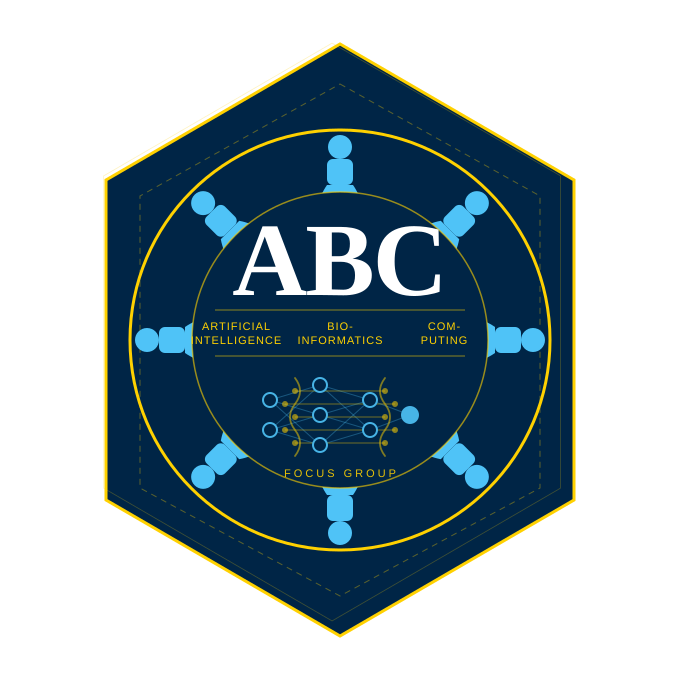

## {#welcome background-color="#003d73"}



<h1>Welcome to the <span>ABC</span></h1>

[AI, Bioinformatics and Computing focus group]{.sub}

[The Health-AI Network and The Personalised Medicine Network, Aarhus University]{.sub}

## Who organises the ABC

::: {.people}


:::

## Coming up next

<ul id="events-list"><li>Loading events…</li></ul>

## Today at the ABC {#today}

<div id="today-box">Loading…</div>

```{=html}
<script>
// Events come live from the calendar data, so the slides never need editing.
fetch('../events/events.json').then(r => r.json()).then(events => {
  const day = d => d.toLocaleDateString('sv'); // local YYYY-MM-DD
  const fmt = s => new Date(s).toLocaleString('en-GB', { weekday: 'short', day: 'numeric', month: 'short', year: 'numeric', hour: '2-digit', minute: '2-digit' });
  const esc = s => String(s ?? '').replace(/[&<>"]/g, c => ({ '&': '&amp;', '<': '&lt;', '>': '&gt;', '"': '&quot;' }[c]));
  const today = day(new Date());
  events.sort((a, b) => a.start.localeCompare(b.start));
  // title format in events.json: "Topic\nName, role\nAffiliation"
  const parts = e => { const [topic, who = '', ...aff] = e.title.split('\n'); return { topic, who, aff: aff.join(', ') }; };

  const next = events.filter(e => day(new Date(e.start)) > today).slice(0, 5);
  document.getElementById('events-list').innerHTML = next.length ? next.map(e => {
    const p = parts(e);
    return `<li><span class="when">${esc(fmt(e.start))}</span> · ${esc(e.location)}<br><strong>${esc(p.topic)}</strong><br><span class="who">${esc([p.who, p.aff].filter(Boolean).join(' · '))}</span></li>`;
  }).join('') : '<li>No upcoming events yet, stay tuned!</li>';

  // today's event, or the next one if there is none today
  const cur = events.find(e => day(new Date(e.start)) === today) || events.find(e => day(new Date(e.start)) > today);
  if (cur) {
    const p = parts(cur);
    document.getElementById('today-box').innerHTML =
      `<div class="topic">${esc(p.topic)}</div><div class="who">${esc(p.who)}</div><div class="aff">${esc(p.aff)}</div>` +
      `<p class="where">${esc(fmt(cur.start))} · ${esc(cur.location)}</p>`;
  }
  if (window.Reveal) Reveal.layout();
});
</script>
```
